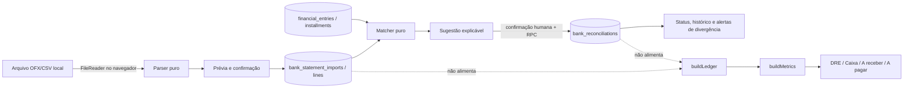

# Conciliação bancária assistida — Design Spec

**Data:** 2026-10-14  
**Status:** implementada; robustez de identidade, saldo e proveniência adicionada em 2026-10-16
**Branches:** `feat/conciliacao-bancaria` e `feat/conciliacao-bancaria-robusta`
**Escopo:** Fase 3 · item 1 — importar OFX/CSV e cruzar com o razão existente  
**Fora de escopo:** contratação/homologação de um conector Open Finance ou banco específico. A fundação neutra de conexão, consentimento e sincronização está modelada, mas nenhum provedor é simulado como integração real.

---

## 1. Goal

Permitir que a clínica importe um extrato bancário em OFX ou CSV, veja cada movimento lado a lado com a parcela correspondente do razão e confirme, ajuste ou desfaça o vínculo sem redigitar informações.

O resultado esperado é responder com segurança:

- o que já foi encontrado no banco;
- o que ainda não tem correspondência;
- o que tem diferença de valor, data ou descrição;
- quem confirmou ou desfez cada conciliação.

Conciliação é um estado aditivo e auditável. Ela **não altera valor, competência, vencimento, baixa, DRE, fluxo de caixa, contas a receber ou contas a pagar**. Um extrato nunca vira fonte paralela de totais financeiros.

### Princípios inegociáveis

1. `src/lib/financialLedger.js` e `buildMetrics` continuam sendo a única fonte dos números financeiros.
2. Nenhuma sugestão é confirmada automaticamente.
3. Confirmar um vínculo não dá baixa, não muda status e não corrige o lançamento.
4. Criar um lançamento a partir do extrato exige formulário e confirmação explícita.
5. Conciliar e desconciliar são reversíveis; não há `DELETE` físico.
6. Todo parse ocorre no navegador. **Nenhuma função serverless nova será criada.**
7. Ambiguidade ou dado inválido interrompe o fluxo com aviso; não há descarte silencioso.

---

## 2. Contexto do cliente

A Dra. Vitória/Lunara recebe o extrato do banco e hoje precisa comparar manualmente cada linha com receitas e despesas já registradas. Isso custa tempo e facilita dois erros graves: considerar como recebido algo que ainda não caiu ou cadastrar novamente uma movimentação que já existe.

O fluxo precisa ser assistido, não automático. O sistema encontra candidatos determinísticamente por direção, valor, data e descrição; a pessoa continua responsável por confirmar o vínculo.

OFX e CSV atendem esta fase sem custo de provedor. Open Finance não entra nesta entrega porque adiciona custo, dependência externa e uma superfície operacional muito maior.

---

## 3. Área e navegação

**Área:** Financeiro  
**Seção lateral:** Cobrança  
**Item:** Conciliação bancária  
**Rota:** `/app/bank-reconciliation`  
**Perfis:** `admin` e `gestao`

A página não será uma aba dentro do componente monolítico `Finance.jsx`. Ela será uma tela própria registrada em `FinanceWorkspace.jsx`, preservando o padrão visual das telas financeiras atuais.

### Estados principais da tela

1. **Sem importação:** selecionar conta e arquivo.
2. **Mapeamento CSV:** identificar colunas quando o cabeçalho não for inequívoco.
3. **Prévia:** conferir período, quantidade, créditos, débitos e linhas inválidas antes de persistir.
4. **Revisão:** filtrar conciliadas, sugestões e sem correspondência.
5. **Histórico:** reabrir uma importação, ver confirmações e desfazer vínculo.
6. **Erro seguro:** schema ausente, razão desatualizado, arquivo ambíguo ou falha de gravação aparecem de forma persistente; nenhum sucesso otimista falso.

### Visual simples

```text
┌ Conciliação bancária ──────────────────────────────────────────────────────┐
│ Conta: [Banco / conta ▼]   Período: 01–31 out   [Importar OFX ou CSV]      │
│ 120 linhas     82 conciliadas     24 sugestões     14 sem correspondência │
├───────────── filtros: [Todos] [Sugestões] [Sem correspondência] ──────────┤
│ EXTRATO                              │ RAZÃO / AÇÃO                         │
│ 13/10  PIX MARIA       + R$ 500,00  │ Receita consulta · Maria             │
│                                     │ R$ 500,00 · baixa 13/10  [Confirmar] │
│                                     │ Motivos: valor exato, mesma data      │
├─────────────────────────────────────┼───────────────────────────────────────┤
│ 14/10  TARIFA BANCO      - R$ 18,90 │ Sem correspondência                  │
│                                     │ [Procurar] [Criar despesa]            │
└─────────────────────────────────────┴───────────────────────────────────────┘
```

No mobile, cada par vira um cartão vertical: movimento do banco, candidato, motivos e ações. Cores nunca serão o único sinal de estado; texto, ícone e `aria-label` acompanham verde/âmbar/vermelho.

---

## 4. Benchmark e referências do repositório

### Comportamento de referência

- ERPs como Olist/Tiny: revisão linha a linha e confirmação humana.
- Apps bancários: importação com prévia, filtros por estado e histórico reversível.
- Não copiar: “IA que concilia sozinha”, alteração automática de baixa ou criação em massa sem revisão.

### Referências internas obrigatórias

- `src/lib/financialLedger.js`: projeção canônica de títulos e parcelas.
- `src/lib/ledgerPersistence.js`: persistência idempotente da projeção.
- `src/financialMetrics.js` e `buildMetrics`: regras das três datas e consumidores oficiais.
- `src/lib/financeStore.js`: carga e gravação dos registros de origem.
- `src/components/LedgerCheck.jsx`: padrão de conferência razão × dashboard.
- `src/components/Finance.jsx`: modal e rascunho atuais para criar receita/despesa.
- `src/pages/FinanceWorkspace.jsx`: navegação, permissões de rota e estado de salvamento.
- `src/context/UserRoleContext.jsx`: autorização de páginas.
- `supabase/financial_ledger_schema.sql`: schema e RLS do razão.
- `supabase/financial_accounts_schema.sql`: contas financeiras às quais o extrato pertence.

---

## 5. Fluxo ideal

### 5.1 Importar e revisar antes de gravar

1. A pessoa escolhe uma conta financeira ativa.
2. Arrasta um arquivo `.ofx`, `.csv` ou `.txt` compatível.
3. O navegador lê o arquivo com `FileReader`; o conteúdo bruto não é enviado nem armazenado.
4. O parser detecta OFX ou CSV. Se CSV for ambíguo, abre o mapeamento de colunas.
5. A prévia mostra período, créditos, débitos, duplicidades e todas as linhas inválidas.
6. Só após **Confirmar importação** são gravados o cabeçalho e as linhas normalizadas.
7. O arquivo bruto é descartado da memória ao sair da prévia.

Limites iniciais: 10 MB e 50.000 linhas por arquivo. Acima disso, o fluxo para com mensagem clara, evitando travar o navegador.

### 5.2 Gerar sugestões

1. A tela carrega do banco as parcelas ativas de `financial_installments`, com o respectivo `financial_entry`.
2. Antes de sugerir, confere que a projeção persistida corresponde aos registros carregados. Se a sincronização/read-back falhar, sugestões ficam bloqueadas.
3. A função pura de casamento recebe linhas normalizadas, parcelas ativas, vínculos ativos e a janela escolhida.
4. O resultado é derivado em memória; sugestões não são persistidas como verdade financeira.
5. A linha recebe um dos estados visuais:
   - **Conciliado:** existe vínculo ativo confirmado.
   - **Sugestão:** existem candidatos determinísticos para revisão.
   - **Sem correspondência:** não existe candidato dentro das regras automáticas.

### 5.3 Confirmar, ajustar e desfazer

- **Confirmar:** cria um vínculo por RPC transacional no Postgres. A RPC é banco de dados, não função serverless da Vercel.
- **Trocar candidato:** busca outras parcelas da mesma direção e mostra diferenças de valor/data antes da confirmação.
- **Vínculo divergente:** valor ou data diferentes exigem confirmação reforçada e justificativa. O sistema registra a divergência; não altera nenhum dos dois lados.
- **Desconciliar:** a RPC preenche `reversed_at`, `reversed_by` e motivo. O vínculo histórico permanece.
- **Parcela pendente:** pode ser vinculada para documentar a correspondência, mas a tela avisa “Conciliação confirmada; baixa financeira ainda pendente”. O status da parcela não muda.
- **Origem alterada depois:** se a parcela for arquivada ou mudar após ressincronização do razão, o vínculo fica visível como “origem alterada” e exige revisão; nunca é migrado silenciosamente para outra parcela.

### 5.4 Criar lançamento a partir da linha

1. Crédito abre o fluxo existente de **Nova receita**; débito abre **Nova despesa**.
2. O rascunho usa `FINANCE_MODAL_DRAFT_KEY` com descrição, valor e datas pré-preenchidos e navega para `/app/finance`.
3. A pessoa deve escolher categoria/grupo, conta, situação e confirmar competência, vencimento e data de caixa. A data do extrato pode sugerir caixa, mas não preenche competência como fato incontestável.
4. O lançamento é salvo pelo fluxo real de `Finance.jsx`/`saveDataNow`, com read-back e sincronização do razão.
5. Somente depois de o lançamento e sua parcela existirem no banco, a tela oferece **Vincular agora**.
6. Cancelar ou falhar mantém a linha sem correspondência. Não há insert direto em `financial_entries` ou `financial_installments`.

---

## 6. Modelo de dados e propagação

### 6.1 Tabelas aditivas

#### `bank_statement_imports`

| Campo | Regra |
|---|---|
| `id` | UUID, PK |
| `user_id` | clínica proprietária; `data_owner_id()` |
| `financial_account_id` | FK para conta financeira da mesma clínica |
| `file_name` | nome sanitizado, sem caminho local |
| `file_hash` | SHA-256 calculado no cliente |
| `source_format` | `ofx` ou `csv` |
| `period_start`, `period_end` | período derivado das linhas |
| `expected_line_count`, `line_count` | quantidade esperada e quantidade confirmada |
| `status` | `importing`, `ready` ou `archived`; só `ready` aparece para conciliar |
| `imported_by`, `created_at` | autoria e auditoria |
| `archived_at` | remoção lógica da importação |

Restrição ativa por `(user_id, financial_account_id, file_hash)` impede reimportar exatamente o mesmo arquivo para a mesma conta.

#### `bank_statement_lines`

| Campo | Regra |
|---|---|
| `id` | UUID, PK |
| `user_id`, `import_id`, `financial_account_id` | escopo e relações |
| `source_line_key` | chave determinística dentro do arquivo |
| `external_id` | `FITID` do OFX quando existir |
| `posted_date` | data bancária normalizada, sem substituir nenhuma das três datas financeiras |
| `amount` | valor assinado; crédito positivo, débito negativo |
| `currency` | `BRL` nesta fase |
| `description`, `normalized_description` | original e versão para casamento |
| `source_metadata` | metadados mínimos, sem conteúdo bruto do arquivo |
| `line_index`, `created_at`, `archived_at` | ordenação e auditoria |

Restrições:

- única por `(import_id, source_line_key)`;
- `external_id` ativo único por `(user_id, financial_account_id, external_id)` quando presente;
- `amount <> 0` e `posted_date` obrigatório;
- sem `ON DELETE CASCADE` que apague histórico financeiro.

CSV não oferece identificador bancário estável. O hash bloqueia arquivo idêntico; sobreposição entre arquivos diferentes gera aviso explícito por conta/data/valor/descrição, nunca deduplicação silenciosa.

#### `bank_reconciliations`

| Campo | Regra |
|---|---|
| `id` | UUID, PK |
| `user_id` | clínica proprietária |
| `statement_line_id` | linha do extrato |
| `financial_installment_id` | parcela persistida do razão |
| `match_method` | `suggested`, `manual` ou `created_from_line` |
| `score`, `match_reasons` | fotografia explicável da sugestão; não recalcula finanças |
| `difference_amount`, `difference_days` | divergências registradas |
| `confirmed_by`, `confirmed_at` | confirmação humana |
| `reversed_by`, `reversed_at`, `reversal_reason` | reversão lógica |

Índices únicos parciais garantem um vínculo ativo por linha de extrato e um vínculo ativo por parcela. Uma linha e uma parcela podem ter histórico antigo revertido, mas não dois vínculos ativos.

### 6.2 Operações atômicas

A migração cria RPCs Postgres idempotentes:

- `start_bank_statement_import(account_id, file_name, file_hash, format, expected_count)`;
- `finalize_bank_statement_import(import_id)`;
- `confirm_bank_reconciliation(line_id, installment_id, method, score, reasons, justification)`;
- `reverse_bank_reconciliation(reconciliation_id, reason)`.

As RPCs:

- são `SECURITY DEFINER` com `search_path` fixo;
- revogam execução de `public`/`anon` e concedem apenas a `authenticated`;
- validam `data_owner_id()`, perfil `admin`/`gestao`, linhas não arquivadas e parcela não arquivada;
- recusam conflito ativo e não fazem upsert que sobrescreva confirmação anterior;
- nunca atualizam `financial_entries`, `financial_installments` ou tabelas operacionais;
- devolvem a linha gravada para read-back; o cliente só mostra sucesso com confirmação do banco.

O início cria um cabeçalho `importing`. O cliente insere linhas normalizadas em lotes com RLS e read-back; a finalização trava o cabeçalho, confere hash, conta, período, conta financeira e duplicidades e então muda para `ready` em uma transação. Se qualquer lote falhar, a importação continua `importing`, fica invisível para o matcher e pode ser retomada ou arquivada — nunca aparece como concluída pela metade.

### 6.3 RLS e auditoria

Todas as tabelas novas têm RLS para `authenticated` com:

```text
USING      (user_id = public.data_owner_id())
WITH CHECK (user_id = public.data_owner_id())
```

FKs e RPCs também validam que conta, linha e parcela pertencem à mesma clínica. Políticas não confiam em `user_id` enviado pelo navegador. A migração registra alterações relevantes no mecanismo de auditoria existente quando `log_record_change()` estiver disponível, sem tornar o schema não idempotente.

### 6.4 Mapa de propagação



**Caminho opcional de criação:**

```text
linha sem correspondência
  → rascunho do modal atual
  → confirmação humana
  → tabela operacional (receita/despesa)
  → buildLedger + syncFinancialLedger
  → parcela persistida
  → confirmação humana do vínculo
```

Não existe seta direta do extrato para DRE, caixa, baixa ou saldo.

### 6.5 Algoritmo determinístico de casamento

O matcher é função pura e recebe configurações explícitas. Não usa IA, rede ou relógio global.

#### Normalização

- caixa baixa, remoção de acentos e pontuação;
- espaços compactados;
- remoção somente de marcadores bancários conhecidos e testados (`pix`, `ted`, `doc`, identificadores numéricos isolados);
- preservação dos tokens úteis de pessoa, fornecedor e descrição;
- datas convertidas para `YYYY-MM-DD` sem inferência de fuso após o parse.

#### Regras duras da sugestão automática

1. Crédito só concorre com parcela `receivable`; débito só com `payable`.
2. Parcela cancelada, arquivada ou já conciliada não concorre.
3. Valor deve ser igual com tolerância de centavos (`abs(diff) <= 0,01`).
4. Data de referência da parcela é `settlement_date` quando houver; senão `due_date`. `issue_date` aparece apenas como contexto, nunca substitui silenciosamente vencimento/caixa.
5. A diferença de datas deve estar na janela configurada, padrão `±3` dias e máximo `±7`.

#### Ranking explicável

- valor exato: pré-condição e maior evidência;
- proximidade da data: peso decrescente por dia;
- similaridade de tokens de descrição/parte: desempate;
- candidato recomendado só existe acima do limiar e com margem segura sobre o segundo colocado;
- empate ou margem pequena vira “sugestão ambígua”, sem candidato pré-confirmado;
- cada parcela pode ser recomendada a no máximo uma linha no mesmo lote.

O resultado traz `score`, motivos e diferenças. Nenhuma pontuação aciona confirmação automática.

Busca manual pode selecionar uma parcela fora das regras duras. Direção incompatível é bloqueada. Diferença de valor ou data exige justificativa e confirmação reforçada, ficando registrada como divergência.

**Limitação consciente do MVP:** conciliação é 1:1. Um depósito agregado para vários lançamentos ou uma parcela dividida em várias linhas fica sem correspondência/ambígua e exige tratamento posterior; a primeira versão não inventa rateio.

---

## 7. Integrações

### Incluídas

- Supabase client já existente para tabelas e RPCs.
- Web Crypto API (`crypto.subtle.digest`) para SHA-256 no navegador.
- `FileReader`/`TextDecoder` para leitura local.
- Razão persistido existente e modal financeiro existente.

### Não incluídas

- nenhuma rota em `api/`;
- nenhuma função Vercel/serverless;
- OpenAI ou outro modelo de IA;
- Open Finance, Pluggy, Belvo ou sincronização bancária;
- upload do arquivo bruto para Storage;
- boleto, cobrança ou baixa automática.

### Formatos suportados

**OFX:** 1.x SGML e 2.x XML, múltiplos `<STMTTRN>`, `FITID`, valores assinados e data OFX com timezone normalizada para a data bancária declarada.

**CSV:** UTF-8 com/sem BOM e fallback Windows-1252; separador vírgula, ponto e vírgula ou tab; campos entre aspas, inclusive quebra de linha; datas `DD/MM/YYYY` e ISO; uma coluna de valor assinado ou colunas separadas de crédito/débito. Formato ambíguo exige mapeamento humano.

Linhas inválidas nunca somem: a prévia mostra número da linha e motivo. A importação só continua quando todas forem corrigidas/excluídas conscientemente ou o usuário cancelar o arquivo.

---

## 8. Permissões

| Ação | Admin | Gestão | Equipe |
|---|---:|---:|---:|
| Ver/importar extrato | sim | sim | não |
| Confirmar/desfazer vínculo | sim | sim | não |
| Criar lançamento pelo fluxo existente | sim | sim | conforme regra financeira atual; rota de conciliação não disponível |
| Ver dados de outra clínica | não | não | não |

`UserRoleContext` e `FinanceWorkspace` escondem/bloqueiam a rota. RLS e RPCs são a barreira de dados mesmo que alguém tente chamar o Supabase fora da interface.

---

## 9. Mapa de arquivos previsto para a implementação

Nenhum arquivo desta tabela será implementado nesta etapa de design.

| Arquivo | Ação futura | Responsabilidade |
|---|---|---|
| `supabase/bank_reconciliation_schema.sql` | criar | tabelas, índices, RLS, RPCs e auditoria idempotentes |
| `src/lib/statementParser.js` | criar | parse puro OFX/CSV e validações |
| `src/lib/bankReconciliationMatch.js` | criar | normalização, score e resolução 1:1 puras |
| `src/lib/bankReconciliationStore.js` | criar | CRUD escopado, paginação, RPCs e read-back |
| `src/components/BankReconciliation.jsx` | criar | importação, prévia, revisão e histórico |
| `src/pages/FinanceWorkspace.jsx` | modificar | rota, título, navegação e injeção dos dados necessários |
| `src/context/UserRoleContext.jsx` | modificar | acesso de admin/gestão à nova página |
| `src/components/Finance.jsx` | modificar de forma mínima | aceitar rascunho originado do extrato e devolver referência do item salvo |
| `tests/fixtures/bank-statements/*` | criar | amostras sintéticas/anônimas OFX e CSV |
| `tests/unit/statementParser.spec.js` | criar | formatos, encodings e falhas seguras |
| `tests/unit/bankReconciliationMatch.spec.js` | criar | casamento determinístico e conflitos |
| `tests/e2e/bank-reconciliation.spec.js` | criar | estados e acessibilidade da interface |
| `tests/e2e-real/bank-reconciliation.real.spec.js` | criar | persistência real, reload, reversão e isolamento |
| `CHANGELOG.md` | modificar | registrar a entrega no mesmo commit |

Se a implementação revelar que `Finance.jsx` precisa de uma API interna grande, extrair apenas o formulário existente para componente compartilhado; não duplicar regras de validação/gravação.

Constantes de estilo específicas da nova tela ficam **dentro do componente**. Não criar paleta em nível de módulo; usar os tokens atuais de tema com contraste em dark/light.

---

## 10. Tasks de implementação

### Task 1 — Parser e fixtures

- implementar leitura/decodificação no cliente;
- cobrir OFX SGML/XML e CSV robusto;
- produzir prévia com erros, sem persistência;
- calcular hash SHA-256 no navegador.

### Task 2 — Matcher puro

- definir tipos de entrada/saída e motivos explicáveis;
- aplicar direção, valor, janela e descrição;
- resolver conflito 1:1 e ambiguidade;
- testar sem Supabase ou UI.

### Task 3 — Schema aditivo

- criar tabelas, constraints, índices e RLS;
- criar RPCs de confirmar/reverter;
- garantir idempotência e privilégios mínimos;
- entregar o SQL para o Felipe rodar manualmente.

### Task 4 — Store e integridade

- carregar importações/linhas/parcela do razão com paginação;
- persistir somente após confirmação da prévia, com ciclo `importing → ready`;
- confirmar todas as escritas por read-back;
- tratar schema ausente e conflito sem sucesso falso.

### Task 5 — Interface

- adicionar navegação e permissões;
- construir upload, mapeamento, prévia, revisão e histórico;
- filtros, teclado, foco, estados vazios/erro/loading;
- validar dark/light e desktop/mobile.

### Task 6 — Criar lançamento e retornar

- usar o modal atual via rascunho tipado;
- preservar a linha/importação de origem no retorno;
- só permitir vínculo depois da persistência e sincronização do razão.

### Task 7 — Testes reais e revisão

- unitários, build e E2E;
- E2E real contra Supabase/local DB, sem mocks no fluxo de persistência;
- reload após cada mutação importante;
- rodar o agente **code-reviewer** antes de qualquer merge;
- corrigir achados e repetir testes.

---

## 11. Checklist de fidedignidade

### Regra #1 — dado errado é pior que dado nenhum

- [x] Extrato e reconciliação não entram em `buildMetrics`.
- [x] Nenhum total paralelo é calculado ou apresentado como saldo contábil.
- [x] Sugestões são determinísticas, explicáveis e nunca auto-confirmadas.
- [x] Arquivo/linha ambígua falha de forma visível, sem descarte silencioso.

### Três datas

- [x] `competence_date` continua alimentando a DRE.
- [x] `due_date` continua alimentando contas a receber/pagar.
- [x] `settlement_date` continua alimentando fluxo/caixa.
- [x] `posted_date` é apenas a data bancária e não sobrescreve nenhuma delas.
- [x] Conciliar uma parcela pendente não cria `settlement_date`.

### Integridade e reversibilidade

- [x] Um vínculo ativo por linha e por parcela, garantido no banco.
- [x] Desconciliação preenche campos de reversão; nunca apaga.
- [x] Lançamento, parcela, linha e vínculo permanecem escopados à mesma clínica.
- [x] Parcela arquivada/origem alterada gera alerta e revisão manual.
- [x] Duplicidade de OFX usa `FITID`; arquivo idêntico usa SHA-256.

### Persistência

- [x] Toda mutação crítica exige resposta/read-back do banco.
- [x] Falha parcial de importação não aparece como sucesso.
- [x] Recarregar a página preserva importações, vínculos e reversões.
- [x] Nenhuma credencial ou arquivo bancário bruto fica em `localStorage` ou Storage.

### Projeto e operação

- [x] Nenhuma função serverless nova.
- [x] SQL aditivo e idempotente em `supabase/`, executado manualmente pelo Felipe.
- [x] RLS por `data_owner_id()` e RPCs com privilégios mínimos.
- [x] CHANGELOG no mesmo commit da implementação.
- [x] Branch própria; sem push ou merge sem pedido.
- [x] Constantes visuais dentro dos componentes novos.

---

## 12. Testes e critérios de aceitação

### Unitários — parser

- OFX 1.x e 2.x, `FITID`, valor negativo/positivo e timezone;
- CSV com `;`, `,`, tab, aspas, vírgula decimal, BOM e Windows-1252;
- coluna única de valor e colunas crédito/débito;
- cabeçalho ambíguo pede mapeamento;
- data/valor inválidos aparecem como erro, não são descartados;
- hash e chave de linha são determinísticos.

### Unitários — matcher

- crédito nunca casa com despesa e débito nunca casa com receita;
- valor exato + data próxima + descrição semelhante recomenda o par;
- mesmo valor/data em duas parcelas vira ambíguo;
- fora da janela ou com valor diferente não vira recomendação automática;
- conflito de duas linhas para a mesma parcela não gera dupla recomendação;
- acentos, caixa e ruído bancário não impedem o casamento;
- conciliada, cancelada ou arquivada não entra como candidata;
- resultado independe da ordem das entradas.

### Integração/E2E real

1. Importar OFX real anonimizado/sintético, confirmar prévia e recarregar.
2. Confirmar sugestão, recarregar e ver o vínculo persistido.
3. Desconciliar, recarregar e ver histórico/reversão.
4. Importar o mesmo arquivo e receber bloqueio de duplicidade.
5. Interromper um lote e comprovar que a importação `importing` não aparece como pronta nem gera sugestões.
6. Criar receita/despesa por linha sem par, confirmar o modal real, voltar e vincular.
7. Simular falha/RLS e verificar que não aparece toast de sucesso.
8. Usuário de outra clínica não lê nem vincula as linhas.
9. Alterar o lançamento de origem e verificar o alerta sem remapeamento silencioso.
10. Comparar antes/depois de conciliar/desconciliar:
   - DRE idêntica;
   - fluxo de caixa idêntico;
   - contas a receber/pagar idênticas;
   - `checkLedgerInvariants` sem novas violações.
11. Validar dark/light, desktop/mobile e navegação apenas por teclado.

### Comandos mínimos

```bash
npm run test:unit
npx playwright test tests/e2e/bank-reconciliation.spec.js
npx playwright test -c playwright.real.config.js tests/e2e-real/bank-reconciliation.real.spec.js
npm run build
```

O E2E real usa o banco local/configurado e dados criados pelo próprio teste. Mocks podem existir em teste visual isolado, mas **não substituem** o fluxo real de importar, persistir, recarregar, conciliar e reverter.

### Critérios de aceite

- nenhuma rota nova em `api/`;
- importação só persiste após prévia confirmada;
- toda sugestão mostra por que foi feita;
- nenhum vínculo acontece sem ação humana;
- vínculo/reversão sobrevivem a reload;
- conciliar não muda nenhum número de DRE/caixa/contas;
- criação por linha usa o cadastro financeiro existente;
- isolamento entre clínicas comprovado;
- unitários, E2E real e build verdes;
- **code-reviewer executado e achados resolvidos antes do merge**.

---

## Riscos de regressão e contenções

| Risco | Contenção |
|---|---|
| Casar pagamentos iguais da mesma data com a pessoa errada | margem mínima entre candidatos, ambiguidade explícita e confirmação humana |
| Duplicar importação | SHA-256 por arquivo/conta, `FITID` e constraints únicas |
| CSV variar entre bancos | parser robusto, mapeamento manual e falha fechada |
| Extrato alterar números financeiros | tabelas aditivas sem consumo por `buildLedger`/`buildMetrics`; teste de invariância |
| Vínculo apontar para parcela recriada/arquivada | FK sem cascade, checagem na RPC e alerta “origem alterada” |
| Duas pessoas confirmarem ao mesmo tempo | índices únicos parciais + RPC transacional; uma recebe conflito visível |
| “Criar lançamento” duplicar registro | fluxo existente com confirmação; vínculo somente após read-back; nunca insert direto no razão |
| Perda silenciosa em falha de rede/RLS | sem sucesso otimista, read-back obrigatório e reload E2E |
| Vazamento entre clínicas | RLS `data_owner_id()`, validação das FKs/RPCs e teste cross-tenant |
| Arquivo grande travar o navegador | limite de tamanho/linhas e validação antes do parse completo |
| Escopo crescer para Open Finance/cobrança | não incluir SDK, webhook, endpoint ou credencial nesta branch |

